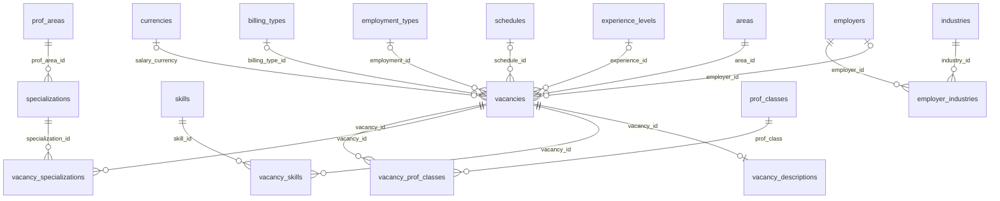

# Как увидеть и собрать схему таблиц hh_lab

Есть два пути:

- **Часть 1: посмотреть готовую схему в IDE.** Занимает 5 минут, диаграмму рисует программа.
- **Часть 2: собрать схему руками.** Занимает 30–40 минут, зато так вы начинаете понимать базу.

Лучше сначала пройти часть 2, а часть 1 использовать как проверку.

## Часть 1. Готовая диаграмма в IDE

В вашем PyCharm CE нет инструментов для работы с базами: окно Database и диаграммы есть только в платной версии Professional. Поэтому нужен отдельный бесплатный клиент, DBeaver Community.

1. Установите DBeaver: скачайте с https://dbeaver.io/download/ или выполните `brew install --cask dbeaver-community`.
2. Создайте подключение: **Database → New Database Connection → PostgreSQL**.
3. Заполните поля и нажмите **Test Connection** (при первом запуске DBeaver предложит скачать драйвер, согласитесь):

   | Поле | Значение |
   |---|---|
   | Host | `localhost` |
   | Port | `5433` |
   | Database | `hh_lab` |
   | Username | `papaskakun` |
   | Password | оставить пустым |

4. Слева откройте **hh_lab → Databases → hh_lab → Schemas → public**.
5. Дважды щёлкните по `public` и перейдите на вкладку **ER Diagram**. Это схема всей базы.
6. Чтобы увидеть связи одной таблицы, дважды щёлкните по ней, например по `vacancies`, и откройте её вкладку **ER Diagram**.
7. Диаграмму можно сохранить в PNG для README: правый клик по диаграмме → **Save diagram as**.

Таблица `raw_vacancies` будет стоять отдельно, без линий. Так и должно быть: это промежуточная таблица для загрузки, и внешних ключей у неё нет.

## Часть 2. Схема вручную

Запросы можно выполнять в ноутбуке через `q("...")`, в DBeaver или в psql:

```bash
/opt/homebrew/opt/postgresql@16/bin/psql -h localhost -p 5433 -d hh_lab
```

### Шаг 1. Составьте список таблиц

```sql
SELECT table_name, count(*) AS columns
FROM information_schema.columns
WHERE table_schema = 'public'
GROUP BY table_name
ORDER BY table_name;
```

Выпишите таблицы на бумагу или в файл. В psql структуру одной таблицы показывает `\d vacancies`, а список всех таблиц — `\dt`.

### Шаг 2. Найдите первичные ключи и определите тип таблицы

```sql
SELECT c.conrelid::regclass AS table_name,
       array_agg(a.attname ORDER BY k.ord) AS pk_columns
FROM pg_constraint c
CROSS JOIN LATERAL unnest(c.conkey) WITH ORDINALITY AS k(attnum, ord)
JOIN pg_attribute a ON a.attrelid = c.conrelid AND a.attnum = k.attnum
WHERE c.contype = 'p'
  AND c.connamespace = 'public'::regnamespace
GROUP BY c.conrelid
ORDER BY 1;
```

Разложите таблицы на группы:

| Признак | Тип таблицы |
|---|---|
| Ключ из одной колонки, строк мало, в основном `id` и `name` | справочник |
| Ключ из одной колонки, строк много, есть ссылки на другие таблицы | основная сущность |
| Ключ из двух колонок, и обе ссылаются на другие таблицы | связующая таблица (многие-ко-многим) |
| Первичный ключ одновременно является внешним | продолжение другой таблицы (один-к-одному) |

### Шаг 3. Выпишите внешние ключи

Каждая строка результата — одна линия на будущей схеме.

```sql
SELECT c.conrelid::regclass  AS from_table,
       a.attname             AS from_column,
       c.confrelid::regclass AS to_table,
       af.attname            AS to_column,
       a.attnotnull          AS required,
       EXISTS (
           SELECT 1 FROM pg_index i
           WHERE i.indrelid = c.conrelid AND i.indisunique
             AND i.indnatts = 1 AND i.indkey[0] = a.attnum
       ) AS unique_fk
FROM pg_constraint c
CROSS JOIN LATERAL unnest(c.conkey, c.confkey) AS k(attnum, fattnum)
JOIN pg_attribute a  ON a.attrelid  = c.conrelid  AND a.attnum  = k.attnum
JOIN pg_attribute af ON af.attrelid = c.confrelid AND af.attnum = k.fattnum
WHERE c.contype = 'f'
  AND c.connamespace = 'public'::regnamespace
ORDER BY 1, 2;
```

Ориентируйтесь на этот запрос, а не на названия колонок. Например, `vacancies.salary_currency` ссылается на `currencies.currency_code`, хотя имена не совпадают.

### Шаг 4. Определите тип каждой связи

| Что видно в результате шага 3 | Связь | Пример |
|---|---|---|
| `unique_fk = true` | один-к-одному | `vacancy_descriptions` → `vacancies` |
| `unique_fk = false`, `required = true` | много-к-одному, ссылка обязательна | `vacancies` → `areas` |
| `unique_fk = false`, `required = false` | много-к-одному, ссылка может быть пустой | `vacancies` → `employers` (у анонимных вакансий работодателя нет) |
| Два внешних ключа образуют первичный ключ | многие-ко-многим через связующую таблицу | `vacancies` ↔ `skills` через `vacancy_skills` |

### Шаг 5. Нарисуйте схему

Нарисуйте от руки или в https://mermaid.live. Удобный порядок такой:

1. В центр поставьте `vacancies`.
2. Вокруг расставьте её справочники.
3. Отдельными ветками добавьте навыки, специализации, классы профессий и работодателя с отраслями.

Начало на Mermaid:

```text
erDiagram
    areas     ||--o{ vacancies : area_id
    employers |o--o{ vacancies : employer_id
    vacancies ||--o| vacancy_descriptions : vacancy_id
    vacancies ||--o{ vacancy_skills : vacancy_id
    skills    ||--o{ vacancy_skills : skill_id
```

Как читать обозначения:

- `||` — ровно один;
- `|o` — ноль или один;
- `o{` — ноль или много.

Этот же код можно вставить в README на GitHub в блоке ` ```mermaid `, и схема отобразится прямо на странице проекта.

### Шаг 6. Проверьте себя

- На схеме 18 таблиц и 17 линий. `raw_vacancies` не считается.
- Внешних ключей больше всего у `vacancies`: 7, плюс 4 таблицы ссылаются на неё саму.
- Самая длинная цепочка идёт от вакансии до профобласти: `vacancies` → `vacancy_specializations` → `specializations` → `prof_areas`.
- Связующих таблиц 4: `vacancy_skills`, `vacancy_specializations`, `vacancy_prof_classes`, `employer_industries`.

Затем проверьте связи на самих данных. Например, есть ли у одной вакансии несколько навыков и один ли навык встречается в разных вакансиях:

```sql
SELECT vacancy_id, count(*) AS skills
FROM vacancy_skills
GROUP BY vacancy_id
ORDER BY skills DESC
LIMIT 5;

SELECT skill_id, count(*) AS vacancies
FROM vacancy_skills
GROUP BY skill_id
ORDER BY vacancies DESC
LIMIT 5;
```

Если обе выборки показывают числа больше 1, связь действительно многие-ко-многим.

В конце сравните свою схему с диаграммой DBeaver из части 1.

## Готовый ответ

Откройте после того, как нарисуете свою схему.

<details>
<summary>Полная схема на Mermaid (17 связей)</summary>



</details>
